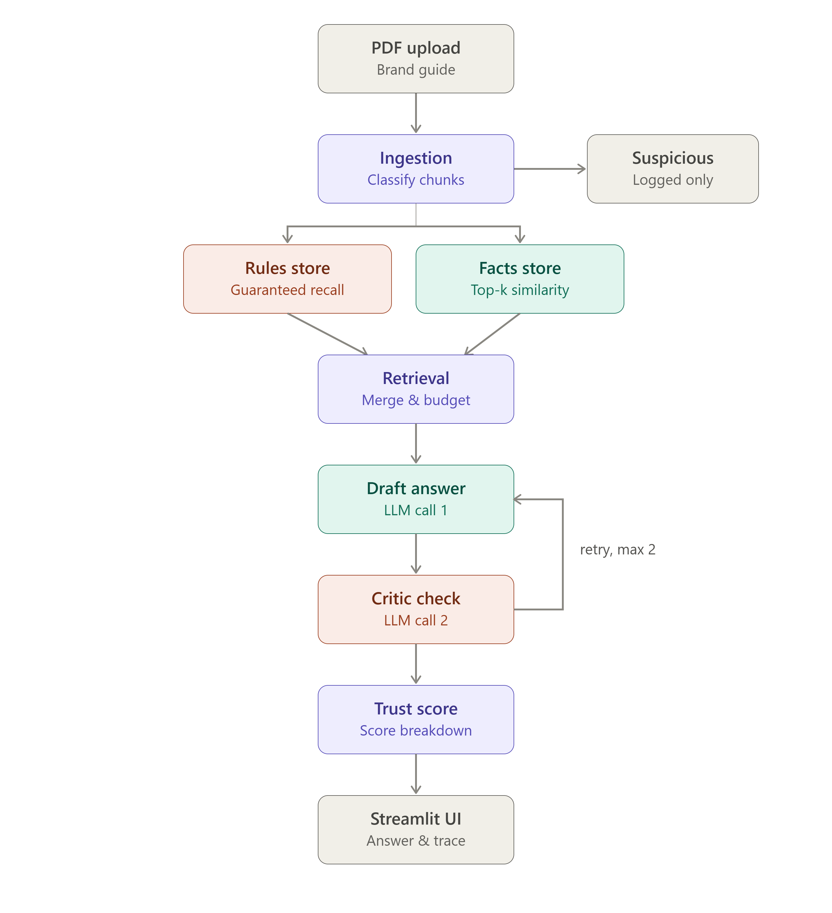

# चित्रगुप्त (Chitragupt) — Brand Memory Engine

**A hallucination-resistant brand Q&A engine with a guaranteed-recall rule retriever, a self-critique loop, and a transparent trust score for every answer.**


*Named after Chitragupt — the divine record-keeper of Hindu mythology, who logs every deed and passes judgment on each one. Fitting, for a system whose whole point is a full audit trail of its reasoning and a critic that judges every answer before it ships.*

Built for the **LOCI Hireathon Challenge 1: Cognition & Brand Memory Engine**.



## Key features

- **Dual-collection retrieval with a rule recall guarantee** — brand rules and facts live in separate Chroma collections with different retrieval strategies, so a critical rule can never be silently dropped by top-k similarity search.
- **Self-critique loop** — every draft answer is checked for rule violations and unsupported claims, then redrafted with critic feedback (max 2 iterations).
- **Transparent trust score** — a composite 0–100 score built from citation coverage and critique pass rate, always shown with its breakdown, never opaque.
- **Prompt-injection quarantine** — chunks that look like injection attempts ("ignore previous instructions"…) are logged to `suspicious_log.json` and never embedded.
- **Automatic LLM failover** — Groq (Llama 3.3 70B) is primary; on any failure the call transparently falls back to Cerebras (gpt-oss-120b). Both free tier.

## Why rules and facts are split into two collections, not one RAG pool

Standard RAG treats all content as a single similarity-searchable pool. That works for facts (specs, product info) where you want the top-k most relevant chunks. It does not work for brand rules (tone constraints, prohibited phrases, style mandates), because a rule can be critical to a query without being the closest embedding match — if the "never use the word X" rule ranks 6th for a query that asks about X, and you only pull the top 4, the rule silently never reaches the model and gets violated.

So this system keeps two separate Chroma collections with different retrieval strategies:

- `facts_collection`: standard top-k similarity search (`query_facts`).
- `rules_collection`: retrieval with a **recall guarantee** — all rules matching relevant category tags (via keyword/tag matching) are returned, falling back to similarity search only if no tag match is confident (`query_rules`). Rules are also never truncated when building context, even under the token budget — facts get truncated first.

## Pipeline

```
PDF
 -> ingestion.py: extract (pdfplumber) -> chunk (paragraph-aware, ~300-500 tok)
                  -> classify each chunk via LLM as rule / fact / suspicious
                  -> suspicious chunks quarantined to suspicious_log.json (never embedded)
 -> storage.py: rule chunks -> rules_collection
                fact chunks -> facts_collection   (both in local ChromaDB)
 -> retrieval.py: build_context(query)
                  -> query_rules() [guaranteed recall, tag match + fallback]
                  -> query_facts() [top-k similarity]
                  -> combine under a 1500-token budget (facts truncated first)
 -> critique.py: draft_answer() [cites chunk_ids inline]
                 -> critique_draft() [checks rule violations + unsupported claims]
                 -> redraft with critic feedback if violated (max 2 iterations total)
 -> scoring.py: citation_score() + compute_trust_score()
                -> composite trust score (0-100) with breakdown, never opaque
 -> main.py (FastAPI): /ingest, /query
 -> app.py (Streamlit UI): upload PDF, ask questions, see answer + thought process + trust score
```

## Quickstart

```bash
pip install -r requirements.txt
cp .env.example .env        # then paste your free GROQ_API_KEY into .env

uvicorn main:app --reload   # terminal 1: backend on http://localhost:8000
streamlit run app.py        # terminal 2: UI on http://localhost:8501
```

In the Streamlit sidebar, upload a brand PDF (a style guide / brand guidelines document works well) and click **Ingest**. Then ask a question in the main query box and click **Submit**. You'll see the final answer with inline chunk citations, an expandable "Thought Process" showing every draft/critique iteration, and the trust score broken down into citation score and pass rate.

Any chunk flagged as an injection attempt during ingestion is logged to `suspicious_log.json` instead of being embedded — check that file to see the quarantine in action.

## Tests

```bash
pip install pytest
pytest -q          # 12 tests, offline: no API keys, no real vector store
```

They check the claims this README makes:
- **Rule recall guarantee:** every rule whose tag matches the query is returned, explicit tags are added, and similarity search is only a fallback.
- **Rules are never trimmed:** when rules use up most of the 1,500-token budget, facts are dropped instead.
- **Trust score:** citation coverage ignores made-up chunk ids, and first-pass acceptance scores higher than a redraft.
- **Chunking:** paragraphs are never split, and chunks stay under the token limit.

## API reference

| Method | Endpoint  | Body                          | Returns |
|--------|-----------|-------------------------------|---------|
| POST   | `/ingest` | multipart file upload (PDF)   | chunk counts by class (rule / fact / suspicious) |
| POST   | `/query`  | `{"query": "..."}`            | answer, trust score, critique log, context used |

Example query:

```bash
curl -X POST http://localhost:8000/query \
  -H "Content-Type: application/json" \
  -d '{"query": "What tone should our social media posts use?"}'
```

```json
{
  "final_answer": "... answer with inline [chunk_id] citations ...",
  "trust_score": {
    "trust_score": 94.0,
    "breakdown": { "citation_score": 0.88, "pass_rate": 1.0 }
  },
  "critique_log": [ { "iteration": 1, "draft": "...", "critic_verdict": { "broke_rule": false, "made_up_claim": false } } ],
  "context_used": { "rules": [ { "chunk_id": "...", "text": "..." } ], "facts": [ { "chunk_id": "...", "text": "..." } ] }
}
```

## Project structure

```
main.py         FastAPI backend (/ingest, /query)
app.py          Streamlit UI
ingestion.py    PDF extraction, chunking, LLM classification, quarantine
storage.py      ChromaDB collections (rules + facts)
retrieval.py    Context builder with rule recall guarantee
critique.py     Draft -> critique -> redraft loop
scoring.py      Citation + trust score computation
llm_client.py   Groq primary / Cerebras fallback with retries
```

## Built entirely on free tiers

| Tool | Role | Cost |
|------|------|------|
| [Groq](https://console.groq.com) | Primary LLM (Llama 3.3 70B) | Free tier |
| [Cerebras](https://cloud.cerebras.ai) | Fallback LLM (gpt-oss-120b) | Free tier |
| [ChromaDB](https://www.trychroma.com/) | Local vector store | Open source, runs locally |
| FastAPI + Streamlit | Backend + UI | Open source |
| GitHub Actions | CI smoke tests | Free tier |

## License

[MIT](LICENSE)
